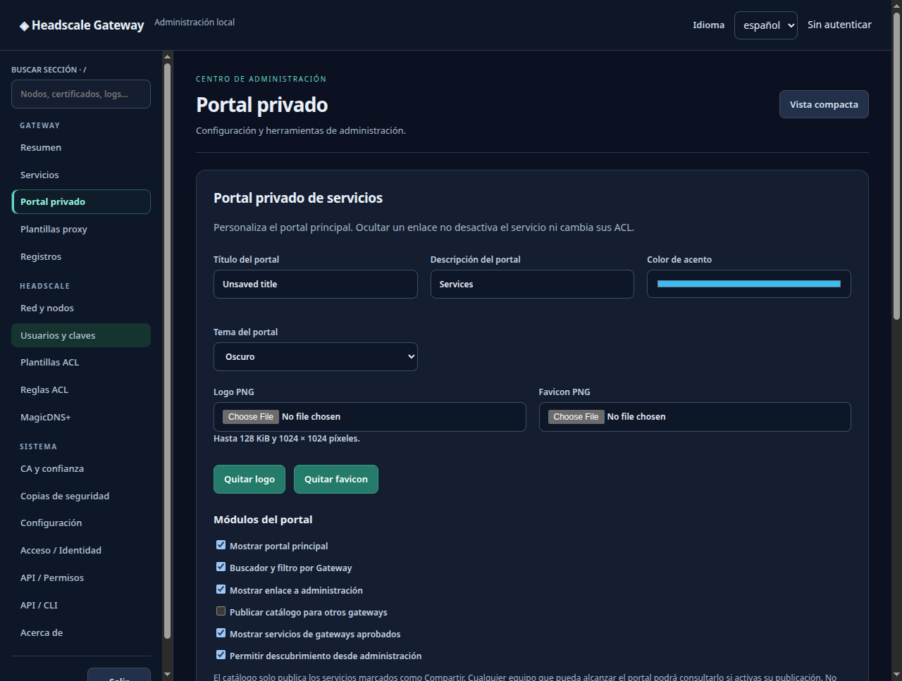
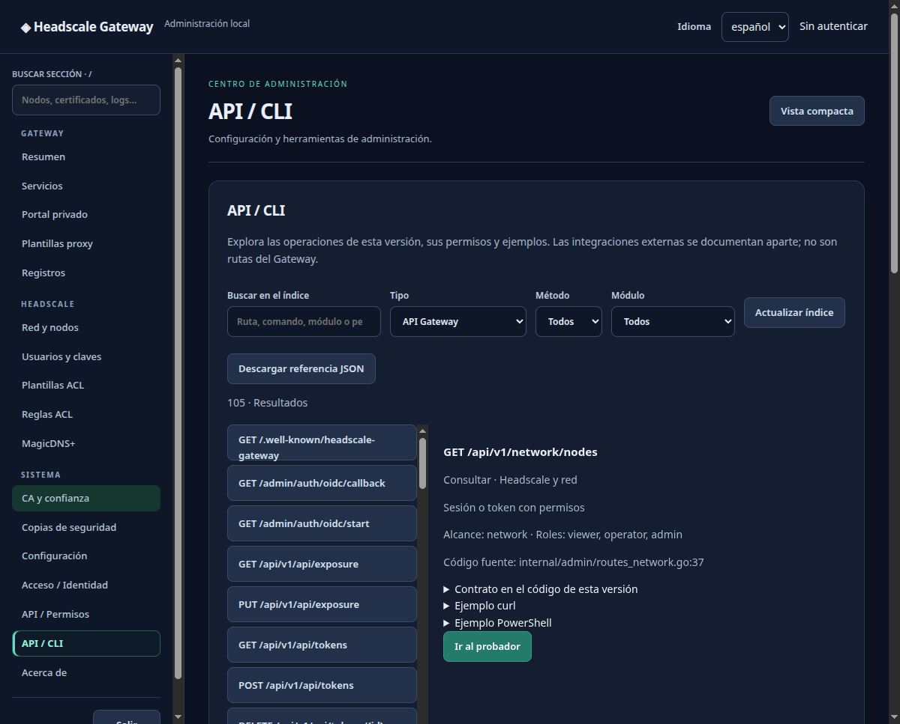
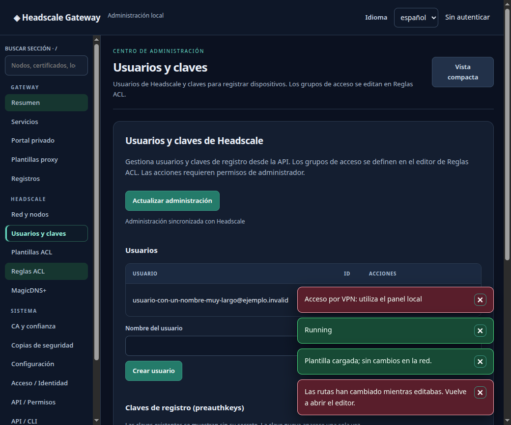
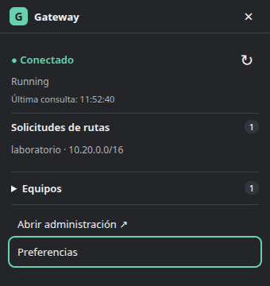

# Capturas del proyecto

Las siguientes imágenes proceden de la interfaz real del repositorio, renderizada con datos ficticios de laboratorio. Permiten reconocer las pantallas y sus controles. Los nombres, estados y fechas de prueba que aparecen en ellas pertenecen a ese laboratorio.

## Portal privado

En **Gateway → Portal privado** se configuran el título, tema, enlaces, publicación del catálogo y servicios remotos. Guarda la configuración antes de actualizar catálogos.

<figure>

<figcaption>Portal de administración. Los textos de prueba dentro del formulario muestran una edición en curso.</figcaption>
</figure>

## API y línea de comandos

El índice muestra métodos, rutas, alcance y roles. Los ejemplos ayudan a construir una petición, y el probador requiere una acción explícita para enviarla.

<figure>

<figcaption>Referencia integrada. El contenido se obtiene de las rutas de la aplicación.</figcaption>
</figure>

## Usuarios y claves

La sección separa el inventario de usuarios y sus claves de la administración de rutas y políticas.

<figure>

<figcaption>Comprobación de la interfaz con nombres largos de laboratorio.</figcaption>
</figure>

## Cliente de bandeja

El cliente de escritorio se conecta a un Gateway existente. Muestra estado y solicitudes pendientes y permite abrir el panel.

<figure>

<figcaption>Cliente de escritorio para Linux. El motor se ejecuta en su propio proceso.</figcaption>
</figure>

## Cómo mantener las capturas

Las fuentes están en `docs/capturas/`. El laboratorio visual está en `src/tools/gui-linux-check/` y usa la misma interfaz HTML y JavaScript que el servidor. El recorrido del panel se reproduce desde la raíz del proyecto con una sesión gráfica Linux.

```bash
npm --prefix src/desktop ci
HGW_REFERENCE_EXPORT=/tmp/hgw-reference-catalog.json \
  go -C src test ./internal/admin -run '^TestReferenceMatchesRegisteredRoutes$' -count=1
src/desktop/node_modules/electron/dist/electron src/tools/gui-linux-check/panel.cjs
```

El script genera las capturas del panel en `docs/capturas/`. La prueba del cliente de bandeja tiene su propio recorrido en `src/tools/gui-linux-check/check.cjs`. Revisa las imágenes antes de guardarlas y actualiza el texto alternativo y el pie si cambia lo que enseñan.
