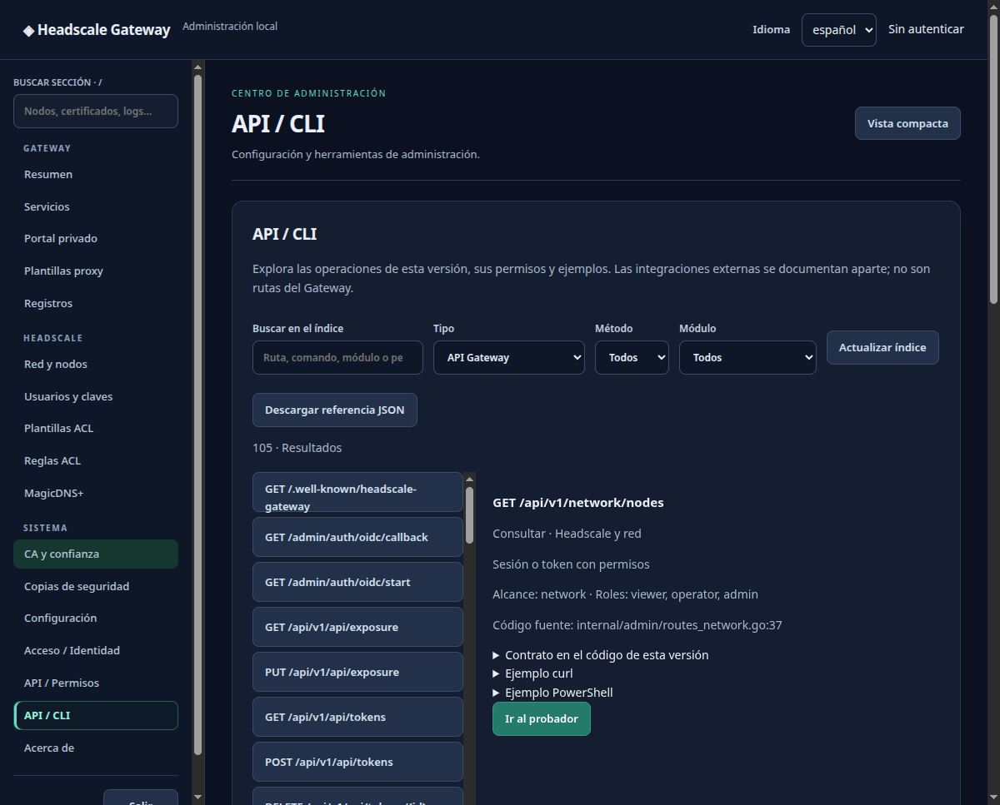

Documentación del proyecto

# Tus servicios privados, paso a paso

Instala Headscale Gateway, conecta tu red y publica tus servicios con HTTPS. Este manual reúne el uso diario, las integraciones y las referencias que necesitas para mantener el proyecto.

[Empezar con el Gateway](PRIMEROS_PASOS.md)
[Instalar en Home Assistant](../packaging/homeassistant/DOCS.md)

<figure>

<figcaption>Panel del proyecto con datos de laboratorio. El índice API muestra las operaciones que registra el servidor. Las capturas utilizan la interfaz del proyecto.</figcaption>
</figure>

[Ver las capturas y su procedencia](CAPTURAS.md)

## Elige por dónde empezar

<section markdown="1">
### Instalar
Encuentra los requisitos, la carpeta correcta y el primer acceso de tu plataforma.

[Home Assistant](../packaging/homeassistant/DOCS.md) · [YunoHost](../packaging/yunohost/doc/ADMIN.md) · [Android](../android/README.md) · [Linux y Windows](USO_COMPLETO.md#instalación-y-primer-acceso)
</section>
<section markdown="1">
### Usar y administrar
Publica tu primer servicio, prepara DNS y certificados y aprende a recuperar el acceso.

[Primeros pasos](PRIMEROS_PASOS.md) · [Ejemplos](EJEMPLOS.md) · [Resolver problemas](SOLUCION_PROBLEMAS.md)
</section>
<section markdown="1">
### Mantener el código
Localiza cada componente, ejecuta las pruebas y prepara una actualización reproducible.

[Estructura](ESTRUCTURA.md) · [Arquitectura](ARQUITECTURA.md) · [Contribuir](../CONTRIBUTING.md)
</section>
<section markdown="1">
### Continuar con otra IA
Parte de los contratos actuales, identifica las fuentes y comprueba cada cambio.

[Guía de continuidad](../AGENTS.md) · [Editar el manual](MANUAL_WEB.md) · [Validación](VERIFICACION_FINAL.md)
</section>

## Qué hace cada pieza

| Pieza | Para qué sirve |
| --- | --- |
| Headscale | Coordina el acceso de los nodos de tu red privada. Debe existir antes de conectar el Gateway. |
| Motor Gateway | Ejecuta el nodo VPN, recibe las conexiones HTTPS y las envía al servicio configurado. |
| Panel de administración | Gestiona servicios, DNS, certificados, acceso, copias y red desde el navegador. |
| Portal privado | Presenta los enlaces a servicios locales y a los de otros gateways aprobados. |
| Integración de Home Assistant | Consulta el estado del Gateway y crea siete entidades. |
| Cliente de bandeja | Muestra estado y notificaciones y permite abrir el panel de una instalación existente. |

Todas las plataformas usan el mismo motor y los mismos formatos de datos. La configuración reside en SQLite. Cada instalación conserva su propia identidad VPN, credenciales y certificados.

## Antes de usarlo

Prepara la URL de Headscale, un nombre estable para el nodo y un dominio resoluble desde tus clientes. Las funciones DNS y la emisión de certificados necesitan sus permisos específicos. El [manual de uso](USO_COMPLETO.md) explica las opciones y los [ejemplos completos](EJEMPLOS.md) utilizan datos ficticios.

La versión del motor se consulta en **Acerca de** o con `headscale-gateway version`. Los paquetes de plataforma y Android tienen comprobaciones específicas pendientes en equipos reales, detalladas en [validación y límites](VERIFICACION_FINAL.md).
